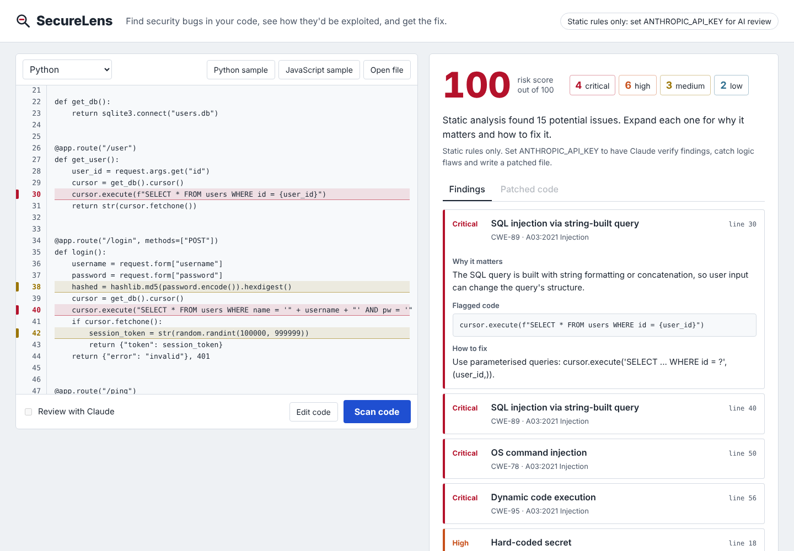

# SecureLens

**AI-assisted code security reviewer.** Paste or upload code and SecureLens finds security bugs with a static analyser, then asks Claude to verify each one, explain how an attacker would exploit it, catch logic flaws the rules can't see, and write a patched version of the file.



[](https://github.com/SANIA9526/securelens/actions)


## Why two layers

Static rules and LLMs fail in opposite ways, so SecureLens uses each to cover the other.

| | Static analyser | Claude review |
|---|---|---|
| Speed and cost | Milliseconds, free | Seconds, paid API call |
| Deterministic | Yes, same input gives same output | No |
| Knows context | No, flags patterns | Yes, can tell if input is attacker-controlled |
| Finds logic flaws (missing auth, IDOR, SSRF) | No | Yes |
| Can hallucinate | No | Yes, so it is anchored to the static findings and real line numbers |

The static layer runs first and its findings are sent to Claude along with line-numbered code. Claude confirms or dismisses each finding, adds what was missed, and returns everything through a **forced tool call with a JSON schema**, so the response is always structured data rather than free text. If the API key is missing or the call fails, the app falls back to static-only results instead of breaking.

## Features

- **13 vulnerability classes**, each mapped to a CWE id and OWASP Top 10 (2021) category: SQL injection, command injection, `eval`/`exec`, insecure deserialization (pickle, unsafe YAML, PHP `unserialize`, Java `ObjectInputStream`), hard-coded secrets (including AWS, GitHub and API-key formats), weak hashes, insecure randomness, disabled TLS verification, debug mode, path traversal, XSS, binding to all interfaces, and `assert` used for access control.
- **Python is analysed with the AST**, not regex, so `cursor.execute(f"...{x}")` is flagged while the parameterised `cursor.execute("... ?", (x,))` is not. JavaScript/TypeScript, PHP and Java use targeted pattern rules.
- **Claude verification**: false-positive dismissal, attack-scenario explanations, per-finding fixes, extra logic-level findings and a fully patched file.
- **Web UI** where flagged lines are marked in the editor gutter by severity. Click a finding to jump to its line, or click a marked line to open its finding.
- **REST API** with OpenAPI docs at `/docs`, file upload, and scan history stored in SQLite.
- **CLI** that exits non-zero on findings, so it can gate a CI pipeline.
- **Dogfooding in CI**: GitHub Actions runs the test suite on Python 3.11 to 3.13 and scans SecureLens's own source on every push, failing the build on any medium-or-worse finding.

## Quick start

```bash
git clone https://github.com/SANIA9526/securelens.git
cd securelens
python -m venv .venv && source .venv/bin/activate     # Windows: .venv\Scripts\activate
pip install -r requirements.txt
cp .env.example .env        # then add your ANTHROPIC_API_KEY (optional)
uvicorn app.main:app --reload
```

Open http://localhost:8000, click **Python sample**, then **Scan code**.

Without an API key everything works in static-only mode.

### Docker

```bash
docker build -t securelens .
docker run -p 8000:8000 -e ANTHROPIC_API_KEY=sk-ant-... -v securelens-data:/data securelens
```

### CLI

```bash
python cli.py examples/                     # scan a folder
python cli.py src/app.py --ai               # add Claude review
python cli.py src/ --fail-on critical       # only fail the build on critical issues
python cli.py src/ --json > report.json     # machine-readable output
```

## API

| Method | Path | Description |
|---|---|---|
| `POST` | `/api/scan` | Scan code: `{"code": "...", "language": "python", "use_ai": true}` |
| `POST` | `/api/scan/upload` | Scan an uploaded source file (multipart, max 200 KB) |
| `GET` | `/api/scans` | Recent scans and totals |
| `GET` | `/api/scans/{id}` | Full result of a past scan |
| `DELETE` | `/api/scans/{id}` | Delete a scan |
| `GET` | `/api/rules` | All detection rules with CWE/OWASP mapping |
| `GET` | `/api/health` | Status and whether AI review is enabled |

## Project structure

```
app/
  scanner.py     static analyser: Python AST visitor + regex rules, CWE/OWASP metadata
  ai.py          Claude review: prompt, JSON schema, tool-forced output, fallback, merge logic
  db.py          SQLite scan history (parameterised queries only)
  main.py        FastAPI routes and static file serving
  static/        frontend (vanilla JS, no build step)
cli.py           command-line scanner for local use and CI
examples/        deliberately vulnerable Flask and Express apps for demos
tests/           57 tests: rule pairs, AI layer with a fake client, API
```

## Testing

```bash
pip install -r requirements-dev.txt
pytest -v
```

Every Python rule is tested as a **vulnerable/safe pair**: the rule must fire on the vulnerable snippet and stay silent on the fixed one, which guards against both missed bugs and false positives. The AI layer is tested with a fake Anthropic client, so the suite runs offline and in CI without an API key.

## Securing the security tool

A code scanner handles untrusted input by definition, so the app follows the rules it checks for:

- The frontend writes all scanned code and AI output with `textContent`, never `innerHTML`, so a malicious file can't run script in the viewer.
- Every SQL query is parameterised.
- The sample-loading endpoint reads from a fixed allow-list, never from a path built from the request.
- Uploads are size-capped and must decode as UTF-8; the client filename is only used for display and language detection.
- The Docker image runs as an unprivileged user.

## How I used AI

AI was part of this project in two ways: it is a component of the product, and it was my pair programmer while building it.

**In the product.** Claude is the second analysis layer. The interesting engineering was making an LLM reliable enough to sit in a security tool:

- *Grounding.* The model gets line-numbered code plus the static findings, and must judge each finding by index. That anchors it to real lines and stops it inventing issues out of nothing.
- *Structured output.* Instead of parsing free text, the request forces a `submit_review` tool call whose input must match a JSON schema. Out-of-range indexes from the model are dropped before merging.
- *Graceful degradation.* Any API failure falls back to static results, which is what keeps CI and offline use working.

**While building it.** I used Claude as a pair programmer for scaffolding the FastAPI app, drafting the regex rules for languages I know less well, writing the test matrix and designing the UI. What I learned about working with AI tools:

- *Tests caught what the AI got wrong.* The vulnerable/safe test pairs exposed real bugs in generated code, for example the regex secret rule flagging `password = "changeme"` placeholders, and `str(random.randint(...))` slipping past the insecure-randomness check because the call was wrapped. I fixed the scanner, not the tests.
- *Reviewing visual output matters.* Screenshotting the UI after each change showed a layout overflow in the findings panel that wasn't visible from the code.
- *I kept the security-critical decisions.* The choice to use AST analysis for Python rather than regex, the allow-listed sample loader, and rendering untrusted output with `textContent` were deliberate design choices I checked by hand.

## Limitations and next steps

- Python analysis is per-file and doesn't track data flow across functions; a taint-tracking pass would cut false positives further.
- JavaScript, PHP and Java use pattern rules; parsing them with tree-sitter would bring them up to the Python layer's accuracy.
- Planned: a GitHub App that comments findings on pull requests, and SARIF output for GitHub code scanning.

## License

MIT. The files in `examples/` are intentionally vulnerable; never deploy them.
